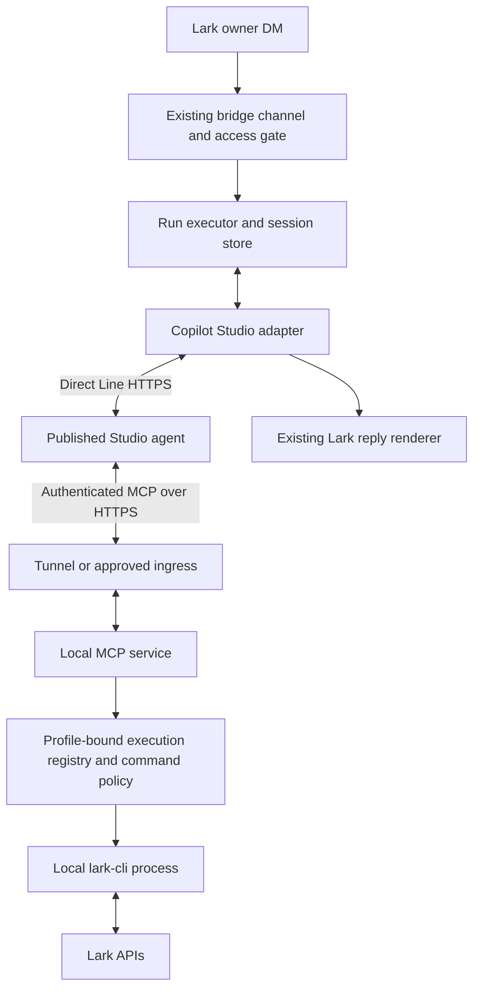

# Copilot Studio integration: design and implementation handoff

Status: proposed design; application implementation has not started.
Prepared: 2026-09-24.

## 1. Objective and scope

Add `copilot-studio` as a third agent alongside Claude Code and Codex. Keep Lark as the chat interface and data source. Copilot Studio supplies reasoning and tool selection; this computer executes Lark operations through the existing profile-local `lark-cli` configuration.

This is a Copilot Studio integration, not the Microsoft 365 Copilot Chat API, GitHub Copilot CLI, or a raw model endpoint. Do not require an Entra application registration for the selected Direct Line route. Do not automate a browser or extract browser authentication tokens.

The owner requested this document for another coding agent to implement. Creating this document does not authorize deployment, publishing changes, opening a tunnel, or sending live Lark messages. Preserve the working Claude profile and unrelated local changes. Never commit credentials or copy the user's live configuration into test fixtures.

Initial release scope:

- One published Studio agent, one bridge profile, owner-only private Lark chat.
- Direct Line conversation transport, initially polling for complete text responses.
- MCP tool service executing validated local `lark-cli` argument arrays.
- A small, explicitly supported read-only command set first; writes in a later phase.
- Profile-local Lark identities, existing access controls, conversation continuity, cancellation of local work, and useful diagnostics.

Deferred: arbitrary terminal commands, local coding, file uploads to Studio, document-comment and meeting triggers, groups, multiple users sharing a Studio agent, native Studio history discovery, and guaranteed token streaming.

## 2. Evidence and open questions

### Verified in this session

The user has Copilot Studio access and successfully published a test agent. Its UI exposes a custom MCP server form with URL and authentication choices, and an App channel with SDK connection information. The SDK connection string becomes available after saving and publishing.

The user followed configuration steps for no Microsoft user authentication plus Direct Line secured access, and explicitly confirmed secured access remained on. Recheck both settings before further live tests.

The user executed these requests locally using a Direct Line secret:

1. POST `https://directline.botframework.com/v3/directline/tokens/generate` returned a token.
2. POST `/v3/directline/conversations` returned a conversation ID.
3. POST `/v3/directline/conversations/{id}/activities` submitted a message.
4. GET the activities endpoint returned `Hello from Copilot Studio` from the agent.

This proves basic Direct Line messaging in this environment. It does not prove MCP execution, tool authentication, turn completion semantics, billing entitlement for sustained use, or parity with local coding agents. Do not ask the user to repeat successful setup unless credentials expired or configuration changed.

No secret belongs in this handoff. The user may have exposed a secret fragment during earlier malformed terminal pastes; ensure the credential used for deployment has been rotated if needed, without requesting it in chat.

### Required feasibility checks

- Can this specific published Studio agent invoke a custom MCP service from a Direct Line conversation, rather than only from Studio Preview?
- Which HTTP transport and API-key header format does this Studio experience support? Use its actual form and current documentation.
- How is tool connection consent completed for a Direct Line caller without Microsoft sign-in? Do not assume the maker's connection automatically applies.
- Which observable activity indicates a completed turn, including a turn with several tool calls and multiple text activities?
- Can Studio propagate a bridge-issued per-run execution capability reliably to MCP calls? There is no assumed automatic Direct Line-to-MCP identity propagation.
- Which model, channel, and MCP limitations apply to this editor? Microsoft has separate standard-harness and newer agent-experience documentation.

Stop expansion at a failed feasibility gate and report the specific failure. Do not present a working chat echo as a completed tool integration.

## 3. Architecture



Two independent connections are required:

1. **Conversation:** the bridge authenticates to Direct Line using a Studio secret exchanged for scoped conversation tokens.
2. **Tools:** Studio authenticates to the MCP endpoint with a separate credential; the endpoint validates an active execution capability before running commands.

Recommend hosting MCP inside the same bridge process for the first implementation. The adapter, local run registry, and executor then share cancellation and correlation state. Standalone mock-MCP tooling is acceptable for the initial spike. Avoid a second long-lived process and cross-process authorization database until needed.

The existing management console remains localhost-only. Do not expose it through the MCP tunnel. Use a separate listener and expose only MCP routes. Bind locally by default. The user must choose an authenticated HTTPS tunnel or approved company ingress; no provider is selected or authorized by this plan. A stable hostname is desirable because Studio stores the URL.

## 4. Configuration and secrets

Add `agentKind: "copilot-studio"` and a dedicated `copilotStudio` configuration object. Preserve root schema version 2 if an additive change is sufficient. Do not reinterpret legacy `copilot` profiles silently.

Proposed fields, subject to existing schema conventions:

| Field | Purpose |
| --- | --- |
| `directLineBaseUrl` | Trusted HTTPS Direct Line origin; default to the global endpoint verified above |
| `directLineSecret` | Existing secret-reference type, not plaintext committed configuration |
| `pollIntervalMs`, `turnTimeoutMs` | Bounded polling and overall run timeout |
| `mcp.bindHost`, `mcp.port` | Separate local listener, loopback by default |
| `mcp.publicUrl` | User-provided HTTPS endpoint configured in Studio |
| `mcp.authSecret` | Independent secret reference for MCP caller authentication |
| `cli.binaryPath` | Locally resolved executable, never controlled by the model |
| `cli.allowedOperations` | Explicit command/argument policies supported by this release |
| `cli.timeoutMs`, `cli.maxOutputBytes` | Server-enforced process limits |

Reuse `SecretInput`/the existing resolver where suitable. Audit encrypted keystore and CLI management commands: current commands are app-secret-oriented and may need a generic named-secret extension. Environment-backed references are a reasonable initial option. Redact secrets in exports, errors, status cards, request logs, and telemetry. Do not pass Direct Line/MCP secrets to `lark-cli` subprocesses.

Restrict Direct Line origins before attaching credentials; do not send them to arbitrary configured hosts or across cross-origin redirects. Local mock endpoints need an explicit test-only mechanism. Account for regional endpoints if future profiles require them.

The MCP service uses the exact profile's projected CLI configuration via `buildLarkChannelEnv`, `LARKSUITE_CLI_CONFIG_DIR`, and the existing identity projection. It must not fall back silently to global user credentials. Preserve `effectiveLarkCliIdentity`, including the existing team-mode override, even though team mode is out of MVP scope.

## 5. Direct Line adapter

Implement the existing `AgentAdapter`/`AgentRun` interfaces. Suggested files: `src/agent/copilot-studio/{adapter,direct-line,activities}.ts`.

Transport responsibilities:

- Exchange the master secret for a token; maintain expiry and token refresh independently from message polling.
- Create a conversation for a new bridge session. Store its ID with the Studio agent/profile identity. Use a generated stable Direct Line user ID; never treat that caller-supplied ID as authentication.
- Send prompts as Bot Framework message activities using correctly encoded JSON.
- Poll with watermarks and deduplicate by activity ID. Filter user echoes and typing/events. Handle multiple bot messages and cards explicitly.
- Record a turn's starting watermark and submitted activity ID; do not replay earlier responses into a new run.
- Retry safe reads with bounded backoff and respect `Retry-After`. A timed-out message POST may already have been accepted: reconcile before retrying; do not blindly resend.
- Surface expired sessions clearly. For the MVP, persist conversation IDs but keep tokens in memory; after restart or unrecoverable expiry, mark the old session unusable and start a clearly announced new conversation. Do not claim transparent restart resume until a documented, tested token/session recovery path exists.

Completion is a feasibility gate. Do not finish on the first bot message or assume a quiet interval proves completion. Capture sanitized sample activities for greeting, simple answer, tool use, multiple messages, error, and interruption. Prefer a documented terminal signal. If unavailable, prototype a dedicated bridge completion tool or another explicit protocol; verify delivery ordering so completion cannot discard a final reply. A model-authored completion signal is a protocol convenience, not an authorization decision. Use a bounded timeout when no reliable signal arrives and document any degraded behavior.

Event mapping:

| Bridge event/method | Studio implementation |
| --- | --- |
| `system` | Expose the conversation ID as the new agent's session ID |
| `final_text` | Render complete answer text once, with deduplication |
| `tool_use` / `tool_result` | Emit only real, correlated events from the local executor |
| `done` | Emit only after the tested completion protocol and pending output are drained |
| `error` | Sanitized transport, protocol, or tool failures |
| `stop()` | Revoke run capability, abort polling, cancel local children, suppress late output |
| `waitForExit()` | Resolve based on local async-run cleanup; there is no local Studio process |

Do not invent thinking, token usage, cost, or internal Studio tool traces. Remote computation might continue after local cancellation. Quarantine/replace an interrupted conversation unless a tested protocol can distinguish its late responses from the next turn.

## 6. MCP tool contract and execution

Use an actively supported MCP SDK and the HTTP transport supported by this Studio experience; verify and pin compatible dependency versions during implementation. Do not implement JSON-RPC/MCP by hand or assume a local stdio server is reachable from Studio.

Proposed general tool:

```ts
type RunLarkCliInput = {
  executionToken: string;
  args: string[];
};

type RunLarkCliOutput = {
  exitCode: number | null;
  stdout: string;
  stderr: string;
  truncated: boolean;
  timedOut: boolean;
};
```

Wrap output in the SDK's valid MCP result format; include structured content when supported. Supply concise command guidance in tool descriptions and published Studio instructions. Discover actual installed `lark-cli` syntax via local help and official documentation. Do not invent operation names or flags from this plan.

Server responsibilities:

- Authenticate requests before MCP operations. Protect discovery and calls consistently while testing Studio's discovery behavior.
- Validate `executionToken` against server-owned profile, run, expiry, permission, and cancellation state.
- Resolve the fixed executable locally. Accept only validated argument arrays, not a shell command, executable name, environment overrides, credential directory, arbitrary cwd, or profile selector.
- Validate flags as well as subcommands. Block auth/config manipulation, identity overrides, arbitrary endpoints, upload/download paths, and unapproved operations in the read-only prototype.
- Use the repository's spawn helper only after auditing Windows `.cmd` shim behavior. `shell: false` alone is insufficient evidence of safety if the helper internally invokes `cmd.exe`. Test metacharacters and use a direct executable/Node entry point where needed.
- Enforce output limits while reading streams, deadlines, cancellation, and child-process-tree cleanup on Windows. Set stdin noninteractive; required login happens in a separate local setup flow.
- Return useful errors without secret leakage. Treat document/message contents as untrusted tool data.

Permission modes need explicit semantics: `read-only` cannot execute writes; `workspace` is not a Lark API sandbox. Document that Copilot's Lark command policy is separate from local coding-agent filesystem sandboxing. Never interpret `full` as permission to run arbitrary shell commands.

## 7. Correlation and authorization

The MCP API key identifies the Studio connection, not the originating Lark user or turn. MCP session IDs and Direct Line conversation IDs are different identifiers. Never authorize a tool call merely because one bridge run happens to be active.

Preferred design: establish trustworthy runtime context propagation through supported Studio features. If that is not available, the owner-only prototype may use a random, short-lived bearer execution token included in the current prompt and required on every tool call:

1. The bridge access gate admits an owner DM.
2. The executor registers an unguessable token mapped to immutable profile/run state.
3. The adapter supplies that token in a clearly separated bridge-context block.
4. Studio passes it to the MCP tool; the server resolves all authority from the registry.
5. Completion, stop, timeout, disconnect, or profile shutdown revokes the token.

This fallback deliberately exposes a capability to the model and Studio conversation history. It is not cryptographic proof of the human sender. Limit it to owner-only DMs and read-only operations until reviewed. Redact it from logs and replies; reject stale, missing, cross-profile, or revoked tokens. Do not infer identity from model-provided sender/profile fields.

Serialize Copilot turns per profile for the first version, in addition to existing per-scope serialization. Do not enable groups, comments, meeting triggers, or multi-user use accidentally through shared channel paths. An MCP call outside an admitted run must fail even when Studio Preview can discover tools.

For writes in a later release: define destination/operation policy, any confirmation requirements, and a server-issued operation identifier for deduplication. A model-chosen request ID alone is not a reliable idempotency guarantee. Do not automatically retry ambiguous mutations.

## 8. Repository integration map

Inspect the current checkout before editing; it may evolve after this handoff.

| Area | Existing files / changes to examine |
| --- | --- |
| Agent contracts | `src/agent/types.ts`, `capability.ts`, `index.ts`; new session kind and capabilities |
| Runtime factory | `src/runtime/agent-runtime.ts`; replace Codex/else-Claude fallback with exhaustive dispatch |
| Preflight | `src/agent/preflight.ts`, `src/cli/preflight.ts`; distinguish remote authentication and local CLI availability from agent binary checks |
| Configuration | `src/config/profile-schema.ts`, `profile-store.ts`, `secret-resolver.ts`, `keystore.ts`; normalization, serialization, export redaction |
| Bootstrap | `src/runtime/profile-runtime.ts`, `src/cli/profile-bootstrap.ts`, `src/cli/agent-detection.ts`; remote profiles need no Claude/Codex binary |
| CLI | `src/cli/index.ts`, `src/cli/commands/profile.ts`, service commands; explicit remote-agent onboarding and clear missing-setting errors |
| Lifecycle | `src/runtime/profile-runtime.ts`, `profile-discovery.ts`, `supervisor.ts`, `run-executor.ts`; start/stop MCP listener and revoke runs |
| Identity | `src/agent/lark-channel-env.ts`, `src/lark-cli/profile-projection.ts`, `identity-policy.ts`; reuse profile projection |
| Policy and sessions | `src/policy/run-policy.ts`, `fingerprint.ts`, `src/session/store.ts`, `catalog.ts`, `history.ts`; remove two-agent assumptions carefully |
| Channel/commands | `src/bot/channel.ts`, `run-flow.ts`, `src/commands/index.ts`; enforce MVP source restrictions, unsupported command handling |
| Presentation | `src/card/*`, `src/ui/onboard.ts`, `src/ui/api.ts`, `web/src/lib/types.ts`, profile/onboarding views; preserve agent kind and surface capabilities |
| Documentation | README files, setup guide, Studio instructions template, troubleshooting and limitations |

Known traps observed in source:

- `AgentKind` and a second agent-kind type in CLI detection only accept Claude/Codex.
- The runtime factory defaults any non-Codex kind to Claude.
- UI onboarding maps any non-Codex input to Claude.
- Session catalog validation and session-ID handling assume two agent kinds.
- Availability diagnostics describe only local binaries.
- Shared bridge prompt text may assume local filesystem/terminal access. Do not forward it unchanged as a trusted Studio system instruction.

Audit agent comparisons with `rg` across source, tests, and web code. Keep local agent discovery distinct from all supported profile types. Preserve existing profiles and validate unsupported kinds with an error naming the offending profile. `/resume` must not enumerate Claude/Codex history for Studio. `/status` should identify remote agent, local tool availability, and session state without credentials.

## 9. Phased implementation and acceptance gates

### Phase A: protocol and MCP feasibility spike

Use an isolated test configuration. Keep the existing live Claude profile intact.

1. Automate a sanitized version of the already successful Direct Line exchange.
2. Implement a minimal authenticated MCP server with a harmless fixture tool.
3. User configures approved HTTPS ingress and the Studio MCP connection, saves, and publishes.
4. Through Direct Line, request a fixture tool call, a multi-step call, and an ordinary answer.
5. Verify connection consent, execution-token propagation, activity correlation, and completion semantics.

Acceptance: a published-agent Direct Line turn calls the authenticated tool, returns its fixture result, and terminates reliably. Capture sanitized protocol fixtures and report remaining limitations. A Preview-only result does not pass.

### Phase B: real read-only CLI execution

Implement the validated argument executor, profile environment, execution registry, output bounds, and cancellation. Add one real read-only Lark operation using the installed CLI's actual syntax.

Acceptance: Studio invokes local `lark-cli` for that operation and answers from its result; invalid arguments, missing/revoked tokens, and wrong MCP credentials cannot spawn a process. The command uses the intended profile identity.

### Phase C: bridge integration

Add schema, adapter, runtime lifecycle, CLI onboarding, session persistence, capability gates, and the minimum web UI changes needed to preserve and display the new profile correctly. Produce useful terminal and `/doctor` errors.

Acceptance: an owner DM travels Lark → bridge → Studio → MCP → local CLI → Studio → Lark. Follow-up context works. `/new`, stop, timeout, and restart have documented behavior. Unsupported sources are rejected before execution. Claude/Codex behavior remains intact.

### Phase D: hardening and documentation

Finish replay handling, token refresh, recovery, process cleanup, redaction, and controlled live acceptance. Include PowerShell-friendly setup and secret entry instructions; earlier multiline pastes were corrupted in the user's interface. Prefer an interactive local setup command over asking for secrets in chat or command arguments.

Acceptance: clean automated checks plus recorded live results, setup/rollback documentation, and explicit list of deferred capabilities. The basic release does not require write tools or broad CLI access.

### Phase E: optional expansion

Only after the earlier gates: expand the command policy, add writes with agreed authorization/idempotency behavior, then consider multi-user routing, group support, attachments, streaming, and service/tunnel deployment. Evaluate these as separate increments rather than claiming full Claude/Codex parity.

## 10. Test plan

Automated tests should use local HTTP/MCP fakes and fake CLI executables, with no live credentials or tenant dependency.

- Direct Line: token refresh, expired token, regional configuration, safe retry/backoff, ambiguous POST, watermark progression, duplicate activities, user echoes, multiple replies, delayed tool calls, completion ordering, cancellation and late responses.
- MCP: protocol negotiation, actual Studio-compatible auth scheme, invalid auth, malformed arguments, output size limits, timeouts, disconnects, execution-token expiry/revocation and cross-profile rejection.
- CLI process: Windows argument metacharacters, Unicode arguments, nonzero exit, stderr handling, no interactive stdin, profile environment and identity overrides, child-tree cleanup.
- Configuration: round-trip serialization, secret-reference resolution and redaction, unsupported kinds, remote bootstrap without installed local agents, unchanged Claude/Codex configs.
- Integration: adapter events render once, owner/source gating, concurrent requests serialize, tool events map to the correct run, `/new` cannot revive old capabilities, restart does not claim false continuity.

Run repository checks in PowerShell:

```powershell
pnpm.cmd install --frozen-lockfile
pnpm.cmd test
pnpm.cmd typecheck
pnpm.cmd build
```

If adding dependencies, update the lockfile intentionally first; the frozen install then verifies reproducibility. Follow existing CI coverage on Windows, Linux, and macOS. Do not add live-network tests to the default suite.

Live acceptance, with the user's published test agent and selected profile:

1. Plain text round trip (already demonstrated manually; automate only as needed).
2. One fixture MCP call through Direct Line.
3. One real read-only CLI operation, then a context-dependent follow-up.
4. Stop/timeout during a controlled long-running fixture; late MCP calls rejected.
5. Confirm unrelated Claude startup, messaging, and profile serialization still work.

## 11. Operational handoff and rollback

Document how to start the profile and MCP listener, configure the approved ingress URL, enter credentials locally, publish Studio instructions/tools, and inspect sanitized logs. Keep model choice in Studio; do not advertise a bridge `/model` setting that Direct Line cannot enforce.

Log run IDs, timings, operation categories, and error codes. Avoid raw message/document bodies by default. Direct Line tokens, stream URLs containing tokens, execution capabilities, MCP keys, and CLI credentials must be redacted.

Rollback: stop the new profile, revoke execution capabilities, stop its MCP listener/ingress, and disable the Studio tool connection. Existing Claude/Codex profiles remain usable. Do not delete the user's original configuration or profile data.

The implementing agent's final report should identify files changed, commands tested, live tests actually performed, external setup still required, and unresolved parity limitations. Never claim deployed integration based only on mocked tests.

## 12. Reference material

Treat these as starting points; verify the applicable agent experience and current protocol versions before implementation.

- [Direct Line authentication](https://learn.microsoft.com/en-us/azure/bot-service/rest-api/bot-framework-rest-direct-line-3-0-authentication): secret and conversation-token handling.
- [Direct Line API reference](https://learn.microsoft.com/en-us/azure/bot-service/rest-api/bot-framework-rest-direct-line-3-0-api-reference): activities, conversations, and regional base URLs.
- [Copilot Studio web channel security](https://learn.microsoft.com/en-us/microsoft-copilot-studio/configure-web-security): secured channel access is separate from user authentication.
- [Custom app integration](https://learn.microsoft.com/en-us/microsoft-copilot-studio/publication-connect-bot-to-custom-application): published-agent Direct Line integration; document is scoped to the standard harness.
- [MCP in the newer agent experience](https://learn.microsoft.com/en-us/microsoft-copilot-studio/agents-experience/tools-add-mcp-server): custom server setup and tool discovery; check applicability to the user's editor.
- [Connect an existing MCP server](https://learn.microsoft.com/en-us/microsoft-copilot-studio/mcp-add-existing-server-to-agent): transport and authentication configuration; verify against the chosen experience.
- [Agents SDK integration](https://learn.microsoft.com/en-us/microsoft-copilot-studio/publication-integrate-web-or-native-app-m365-agents-sdk): an alternative path, not required for the demonstrated Direct Line design.

## 13. Suggested instruction to the implementing agent

> Read this document and inspect the current repository. Implement in the phase order above. Start with the published-agent Direct Line-to-MCP feasibility gates; do not expand into a broad refactor before those pass. Preserve the working Claude/Codex integrations. Never request secrets in chat or commit live credentials. Identify external setup explicitly and complete all local, reviewable work before asking the owner to configure or publish it. Report failed gates honestly and do not substitute browser automation or model-written shell instructions for the specified integration.
